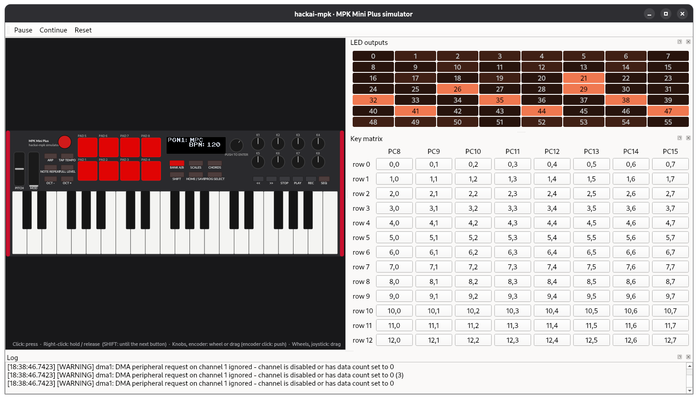

# hackai-mpk

Community firmware and hardware mods for AKAI MPK mini controllers, starting
with the **AKAI MPK Mini Plus**.

The goal is to extend what the controller can do without losing what it
already does well: proper MIDI THRU, pad LEDs driven over MIDI, more
arpeggiator modes and, as an optional hardware mod, an internal battery with a
charge indicator on the display.



*The stock firmware running unmodified in the simulator (`make gui`): OLED,
pad and button LEDs, buttons, pads, knobs, wheels, joystick and encoder, plus
panels to reverse-engineer the LED chain and the key matrix.*

## Supported models

| Model | Status |
|---|---|
| **AKAI MPK Mini Plus** (stock firmware v1.13) | 🟡 Current target: all the work so far |
| AKAI MPK mini mk3 | ⚪ Planned |

Everything in this repository (docs, tools, simulator) currently refers to the
MPK Mini Plus. Support for other models, starting with the MPK mini mk3, is
planned once the MPK Mini Plus work is mature. Their hardware and firmware
still have to be analysed, so nothing here should be assumed to apply to them.

> [!WARNING]
> This is an **unofficial** project. It is not affiliated with, sponsored or
> endorsed by AKAI Professional or inMusic Brands. Flashing modified firmware or
> opening the unit **voids your warranty** and may brick the device. Use at
> your own risk.

---

## Status

Early stage. The table shows the plan, not finished features.

| Feature | Type | Status |
|---|---|---|
| Hardware and stock firmware documentation | Research | 🟡 In progress |
| Reproducible analysis pipeline (Ghidra from text) | Tooling | ✅ Done |
| Simulator (stock firmware in Renode, panel GUI) | Tooling | 🟡 Boots; OLED, LEDs and buttons work |
| Safe flashing over USB (`tools/mpkflash.py`) | Foundation | ✅ Done, tested on a real unit |
| Custom screensaver image (`make screensaver`) | Mod (data) | ✅ Done, tested on a real unit |
| Patch system: our C code + hooks (`make mod`) | Foundation | ✅ Done, tested on a real unit |
| Own entries in the Global menu (THRU on/off) | Firmware | ✅ Done, tested on a real unit (setting only) |
| MIDI THRU on the MIDI OUT port | Firmware | 🟡 Works in the simulator |
| Per-pad MIDI channel | Firmware | 🟡 Works in the simulator |
| MIDI feedback on the RGB pad LEDs | Firmware | ⚪ Planned |
| New arpeggiator modes | Firmware | ⚪ Planned |
| Internal battery + on-screen indicator | Hardware + firmware | ⚪ Planned |

Legend: ✅ done · 🟡 in progress · ⚪ planned

---

## Planned features

### 1. MIDI THRU on MIDI OUT

The MPK Mini Plus has 5-pin DIN MIDI IN and OUT sockets, but whatever comes in
on MIDI IN is not forwarded to MIDI OUT. The plan is a configurable *soft THRU*:

- **DIN IN → DIN OUT**: forward the physical input.
- **USB → DIN OUT**: let the computer use the MPK as a MIDI interface for
  external synths.
- **Merge**: mix the keyboard's own messages with the THRU stream on MIDI OUT.
- Optional filters by channel and message type (clock, SysEx, Active Sensing…).
- Latency first: forwarding must not add noticeable delay or disturb MIDI
  Clock timing.

### 2. Per-pad MIDI channel

The stock firmware sends all pads on one MIDI channel. The plan is to let
each pad have its own channel (and note), for example PAD 1 on channel 1,
PAD 2 on channel 2… With an Elektron Digitakt (one track per channel) that
turns the pads into a finger-drumming controller for its tracks.

- Channel per pad, stored with the program (or as a global option).
- Editable from the controller (pad + encoder) and, ideally, by SysEx.
- Works with Note Repeat and Full Level.

### 3. MIDI feedback on the pad LEDs

Let the RGB pads show the state of the DAW or another device, the way
grid controllers do:

- **Note On** on a pad's channel/note → the pad lights up; **velocity**
  selects a colour from a fixed palette.
- **Note Off** or velocity 0 → back to the default colour.
- Optional **SysEx** message to set an arbitrary RGB colour per pad.
- Feedback channel configurable separately from the transmit channel.

The palette and mapping will be documented in [`docs/`](docs/) to make DAW
scripts (Ableton, Bitwig, Reaper…) easy to write.

### 4. New arpeggiator modes

On top of the factory modes:

- **Converge / Diverge**: from the outside in, and back.
- **Pinky / Thumb**: alternate each note with the highest (or lowest) one.
- **Random walk**: random ±1 step instead of fully random.
- **Chord**: play all held notes on every step.
- **Euclidean**: spread *k* hits over *n* steps.
- Per-step extras: **probability**, **ratchets** and velocity variation.

### 5. Internal battery (hardware mod)

Optional mod to use the MPK without a USB cable:

- 1S Li-ion/LiPo cell with a **protection circuit** (over-charge,
  over-discharge, short circuit).
- Charger with *power path* from USB, so the unit works while charging.
- Boost converter to the supply rail, sized for LEDs and display.
- Charge measurement with an I²C **fuel gauge** or a resistor divider into a
  free ADC pin.
- **Battery icon on the OLED**, drawn by the firmware.

> [!CAUTION]
> Badly installed lithium batteries can catch fire. Always use cells with a
> protection circuit, never puncture or squeeze them, and insulate them well
> inside the case.

Schematics, BOM and build guide will live in `hardware/`.

---

## The hardware at a glance (MPK Mini Plus)

| Item | Value |
|---|---|
| MCU | Artery **AT32F415RCT7**: Cortex-M4, 256 KB flash, 32 KB SRAM, LQFP-64 |
| Debug | Populated SWD/JTAG header on the main board |
| Display | SSD1306-compatible OLED, probably 128 × 32, on SPI2 + DMA |
| Flash layout | 20 KB bootloader + 20 KB bootloader update payload + application at `0x0800A000` |
| Controls | 37 keys, 8 RGB pads, 8 endless knobs, pitch and modulation wheels, X/Y joystick, push encoder, 18 buttons with LEDs |
| I/O | USB Type-B, MIDI IN/OUT (5-pin DIN), CV/Gate/Mod outputs, clock in/out, sustain pedal |

Full details and open questions are in [`docs/`](docs/README.md):
[hardware](docs/hardware.md) · [firmware image](docs/firmware-image.md) ·
[Ghidra setup](docs/ghidra-setup.md) · [display](docs/display.md) ·
[research log](docs/re-log.md).

---

## Analysing the firmware

The analysis is reproducible: the knowledge lives in text files under
`config/`, and the Ghidra project is rebuilt from them with one command. You
need Python 3.11, Ghidra 11.3 and 7-Zip (details in
[docs/tools.md](docs/tools.md)).

```bash
make setup                                    # Python venv with PyGhidra
make baserom SRC=/path/to/MPK_mini_Plus_Updater_v1.13.exe
make ghidra                                   # build build/ghidra/hackai-mpk.gpr
```

Rename things in Ghidra, then run `make export` to save your names in
`config/symbols.csv`. `make gui` runs the stock firmware in
[Renode](https://renode.io) behind a panel of the controller (OLED, LEDs,
buttons), see [docs/simulator.md](docs/simulator.md). The strategy and milestones are in
[docs/decomp-plan.md](docs/decomp-plan.md).

---

## Repository layout

```
hackai-mpk/
├── baserom/       # Your copy of the stock firmware (not in git)
├── config/        # Source of truth: segments, symbols, firmware hash
├── docs/          # Reverse-engineering notes, memory map, protocols
├── sim/           # Renode simulator: platform, board and peripheral models
├── tools/         # Scripts: firmware extraction, Ghidra build and export
├── mods/          # Our own assets for mods (e.g. screensaver images)
├── firmware/      # Our own code (C): patches and new features, see docs/patching.md
├── hardware/      # Battery mod schematics, PCB and BOM (planned)
├── Makefile
├── LICENSE
└── README.md
```

---

## Installation

> Early days. What works today, from your own copy of the stock firmware
> (`make baserom`, see [docs/firmware-image.md](docs/firmware-image.md)):
>
> 1. Build a modded image, e.g. a custom screensaver:
>    `make screensaver PNG=my_image.png` ([docs/screensaver.md](docs/screensaver.md)).
> 2. Try it in the simulator: `make screensaver-sim`, or `make flash-sim IMAGE=…`.
> 3. Flash it over USB with the unit in update mode (hold SHIFT + PROG SELECT
>    while plugging it in): `make flash IMAGE=…` ([docs/updater.md](docs/updater.md)).
>
> The bootloader is never overwritten over USB, so a bad image can always be
> fixed by flashing again from update mode. SWD recovery is still to be
> documented.

**This repository does not distribute AKAI's original firmware.** The tools
will work on the copy each user extracts from the official updater or from
their own unit.

---

## Contributing

Help is very welcome, especially if you own an MPK Mini Plus and are happy to
test. Before opening a pull request:

- Do not commit binaries or pieces of the original firmware, or memory dumps.
  Describe behaviour and give addresses instead of pasting decompiled code.
- Document any new finding (addresses, protocols, pinouts) in `docs/`.
- State which stock firmware version you tested your changes on.

---

## License

- **Code** (`firmware/`, `tools/`, `sim/`): [GNU GPL v3.0 or later](LICENSE)
  (`GPL-3.0-or-later`).
- **Documentation** (`docs/`, this README):
  [CC BY-SA 4.0](https://creativecommons.org/licenses/by-sa/4.0/).
- **Hardware** (`hardware/`): [CERN-OHL-S v2](https://ohwr.org/cern_ohl_s_v2.txt).

All three are free licenses with *copyleft*: anyone may use, study, modify and
redistribute the project, but modified versions that are distributed must keep
the same license and publish their sources.

These licenses cover **only this project's original work**. The stock
firmware, the "AKAI" and "MPK" trademarks and any other AKAI Professional /
inMusic Brands material remain the property of their owners.
