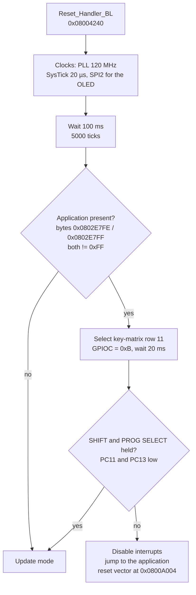
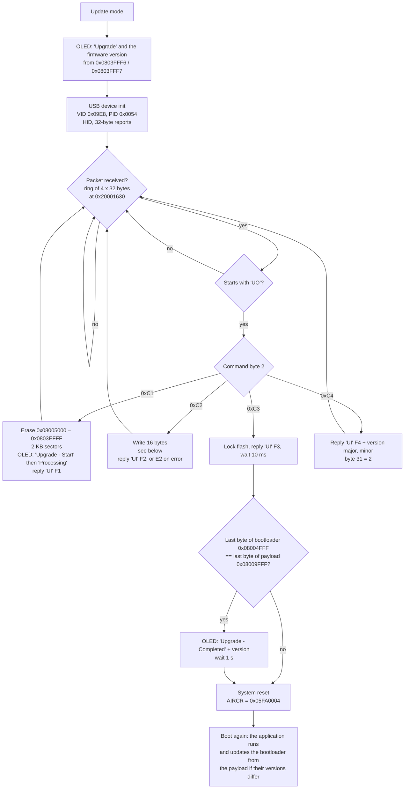

# Bootloader

The first 20 KB of flash (`0x08000000`–`0x08004FFF`) hold the bootloader. It
decides whether to start the application or to enter **update mode**, in which
it takes a new firmware over **USB HID**. Found by decompiling it and running it
in the simulator.

## Boot decision

`bootloader_main_BL` (`0x08003DC8`):

There is **no checksum of the application**: only the two marker bytes.

## Update mode

### Packets

Host → device (HID OUT, 32 bytes):

| Bytes | Content |
|---|---|
| 0–1 | `55 4F` ("UO") |
| 2 | Command: `C1` erase, `C2` write, `C3` finish, `C4` query version |
| 3–6 | `C2`: address, big endian, OR-ed with `0x08000000` |
| 7–8 | Unused (to check) |
| 9–24 | `C2`: 16 data bytes |
| 30–31 | `C2`: 16-bit sum of the 16 data bytes, big endian |

Device → host (HID IN, endpoint `0x81`, 32 bytes): `55 49` ("UI"), then a
status in byte 2: `F1`–`F4` = done for `C1`–`C4`, `E2` = write rejected (bad
checksum or address beyond flash). `F4` carries the firmware version in bytes
3–4 (BCD, e.g. `01 13`) and `02` in byte 31 (protocol version?).

### Where `C2` writes go

| Address | What happens |
|---|---|
| below `0x08005000` | **Ignored** (replies `F2`): the bootloader cannot overwrite itself over USB |
| `0x08005000`–`0x0803EFFF` | Written to flash (bootloader payload, application, presets) |
| `0x0803F000`–`0x0803F7FF` | Ignored (replies `F2`) |
| `0x0803F800`–`0x0803FFFF` | **Configuration sector**: buffered in RAM (`0x20000C30`). When the last 16 bytes arrive (`0x0803FFF0`, the trailer), the bootloader writes the serial string `A00000000000001` at the start, keeps the **2000 bytes of calibration** at `0x0803F820` from the current flash if the configuration layout byte (`0x0803FFF5`, `0C` in v1.13) is unchanged, then erases and rewrites the 2 KB sector |
| `0x08040000` and above | Rejected (`E2`) |

The configuration sector ends with the trailer
`09 E8 | 00 54 | FF | 0C | 01 13 | FF… | B2 47`: USB VID and PID, layout
version, firmware version (BCD), and two bytes not checked by the bootloader
(checksum for the host tool?).

## USB

- Device descriptor (`0x08004492`): VID `0x09E8` (inMusic), PID `0x0054`.
- Configuration with 3 interfaces; interface 0 is **HID** (report descriptor
  of 52 bytes), interrupt endpoints `0x81` IN and `0x01` OUT, 32 bytes.
- The application has the same HID interface (descriptor at `0x08025C39`),
  probably for the program editor. Its handler (`hid_process_packet_APP`,
  `0x08024628`) answers a `UO` `C4` packet with `UI` **`E4`** and ignores every
  other command: an update tool can tell the application from the bootloader
  (`F4`) safely. See [updater.md](updater.md).

## What this means for mods

- **The bootloader is safe from USB updates**: writes below `0x08005000` are
  ignored. A bad application image can always be fixed by entering update
  mode (hold SHIFT + PROG SELECT while powering on) and flashing again.
- **But the application can rewrite the bootloader**: at boot it copies the
  payload at `0x08005000` over the bootloader when their last bytes differ
  (see [firmware-image.md](firmware-image.md#boot-sequence)). A modded image
  must keep the payload **identical to the stock one**, or a broken payload
  could brick the device (then only SWD can save it).
- The application-present marker (`0x0802E7FE`–`0x0802E7FF`) must stay
  non-`0xFF`.
- Per-packet 16-bit sums are the only integrity check: our own updater must
  verify the result (read back, or check the boot) itself.
- **No anti-rollback**: no version is ever compared, any image can be written.

## Function names

Applied in `config/symbols.csv`:

| Address | Name | Was |
|---|---|---|
| `0x08003DC8` | `bootloader_main_BL` | `bootloader_POSSIBLE_BL` |
| `0x080024E8` | `update_process_packet_BL` | `flashing_firmware_BL` |
| `0x08003DAC` | `system_reset_BL` (NVIC_SystemReset) | `HardFault_POSSIBLE_BL` |
| `0x08002D1C` | `oled_clear_page_BL` | `FUN_08002d1c` |
| `0x080031E4` | `usb_send_report_BL` (endpoint, data, length) | `FUN_080031e4` |

## Open questions

- [ ] HID report descriptor (52 bytes) and the other two interfaces.
- [ ] How the official updater sends a running unit to update mode. Not
      through `UO` packets: the application only answers `C4` (with `E4`).
- [ ] Bytes 7–8 of `C2` packets, and the last two trailer bytes (`B2 47`).
- [ ] Packet order in the official updater (does it write the config sector
      last?).
